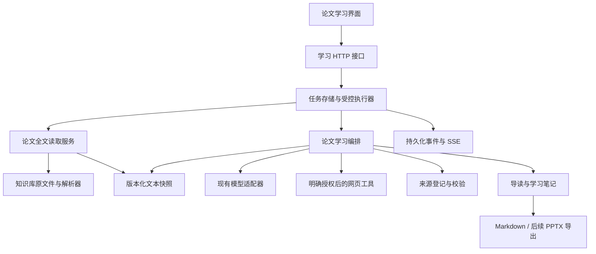

# Study Agent V4 技术设计：面向理解的论文学习

- 日期：2026-10-02
- 状态：设计稿，待实现；本文不代表功能已经交付或通过运行验证。
- 产品目标：帮助用户自己学懂论文，默认先建立整体理解，再按不懂的地方逐层展开。
- 交付顺序：先完成论文导读、按需追问、学习笔记和过程回看；随后增加笔记到 PPTX。

## 1. 需求与边界

### 1.1 已确认的产品决策

1. 核心用途是个人学习，而非默认生成组会汇报。
2. 论文模式默认关闭；只有用户开启并选定论文，才自动进行全文阅读与简明导读。不一次性展开全部前置知识、公式和自测题。
3. 用户可针对导读中的段落继续提问，选择概念解释、公式拆解、举例说明等方式。
4. 有帮助的解释由用户主动加入学习笔记；笔记支持编辑、保存和 Markdown 导出。
5. 论文事实可定位到原文；教学解释、外部补充和用户笔记分别标识。
6. 执行过程可回看，阅读失败及未覆盖部分明确展示。
7. PPT 从用户选定的笔记版本生成，先编辑逐页大纲，再导出文件。

### 1.2 阶段 A 范围

开启论文模式并选择知识库中的单篇文本型 PDF → 自动获取全文快照、分批整理证据并生成简明导读 → 用户按需追问 → 主动保存学习笔记 → 下载 Markdown、回看任务时间线。

首期只要求按页定位和文本引用。章节名称由可验证的标题识别结果提供，识别失败时使用页码。不承诺 PDF 原文框选、复杂公式恢复、图表自动提取或 OCR。

### 1.3 阶段 B 范围

选择已保存笔记版本 → 生成可编辑的逐页大纲 → 用户调整页数和重点 → 生成并下载 PPTX。

首期 PPT 采用有限模板，支持标题、文本、列表、简单表格和来源说明。复杂公式优先保留可读文本及原文定位；论文图片提取和高保真公式排版单独扩展。

### 1.4 暂不纳入

多篇论文自动比较、论文 URL 自动下载、登录与多人权限、多 Agent 编排、自动推断用户已经掌握知识、自动写入长期记忆，以及无上限的自主研究。

保存学习笔记不自动写入知识库。后续可增加明确的“导入笔记”操作，并保留生成内容属性，防止检索时把教学解释当成原论文证据。

## 2. 当前代码基线与缺口

以下结论来自代码检查，未在本次文档任务中重新运行验证。

| 代码 | 当前能力 | V4 所需补充 |
| --- | --- | --- |
| [PDF 解析器](../../app/parsers/registry.py) | 非空页文本和一基 PDF 页码；空页跳过 | 总页数、空白/提取失败页记录、稳定文本块与质量提示 |
| [知识库服务](../../app/knowledge_base/service.py) | 原文件、SQLite 元数据、Chroma、检索/删除/重试 | 受控读取指定文件、版本化全文快照、按文件限定检索 |
| [V2 编排](../../app/agent/v2.py) | 检索、证据分级、K 引用、授权后联网 | 全文导读流程和围绕论文块的追问流程 |
| [V1 图](../../app/agent/graph.py) | 工具循环、搜索预算、任务超时、进度回调 | 可复用调用预算封装；保持普通问答行为 |
| [会话服务](../../app/services/sessions.py) | 持久化记录、摘要、长期记忆及近期窗口 | 学习记录独立存储，显式关联会话或问答轮次 |
| [HTTP 入口](../../app/main.py) | FastAPI、聊天 SSE、知识库/会话/记忆接口 | 学习任务、笔记、来源与事件查询接口 |
| [前端](../../app/static/index.html) | 聊天和管理界面；状态文字结束后移除 | 导读、笔记、追问入口、持久化时间线 |
| [依赖配置](../../pyproject.toml) | 已包含 pypdf 和 python-pptx | 阶段 A 暂不要求新增运行依赖；阶段 B 再验证导出和渲染条件 |

D 盘主项目 README、CONTEXT 已记录 V3 分层记忆；API 与包版本均为 0.3.0。本文以 D:/codex/Study-agent 为实施目录；实施时需同步实际状态，不能仅修改版本号宣称迭代完成。

约定中的 `docs/agents/issue-tracker.md`、`docs/agents/triage-labels.md`、`docs/agents/domain.md` 当前不存在，本文不臆造其规则。

## 3. 用户流程与界面

### 3.1 论文模式开关与简明导读

聊天界面增加“论文模式”开关，默认关闭，设置限定在当前会话。新会话默认关闭；重新打开已有会话恢复其已保存设置，但恢复界面本身不启动任务。用户无需填写学习基础即可开始，可选填写关注点。默认用中文讲解，术语保留必要的原文名称。

| 状态或操作 | 系统行为 |
| --- | --- |
| 模式关闭 | 沿用普通聊天或知识库问答；上传 PDF、提问包含“论文”、检索命中论文均不自动创建学习任务 |
| 开启但未选择论文 | 显示单篇 PDF 选择器，提示选择论文；不开始全文处理 |
| 开启且选定论文 | 自动创建一次全文阅读与简明导读任务；界面立即显示任务状态 |
| 同一论文、快照已有成功导读 | 优先展示已有导读；只有用户点击重新生成才新建任务 |
| 切换论文 | 取消当前会话旧论文的未完成学习任务，为新论文展示或生成导读，不混用上下文 |
| 关闭模式 | 后续输入恢复原问答路由，取消当前会话未完成的论文学习任务；保留已保存产物和事件 |
| 刷新或重新打开会话 | 恢复模式、论文和已有任务状态；不重复触发任务，也不自动重试失败或中断任务 |

模式开启只自动生成导读。概念解释、公式拆解、举例、自测、加入笔记和 PPT 均由用户主动触发；正常发送的问题只执行本次追问，不连带生成整套产物。联网授权与论文模式独立，开启模式不代表允许联网。

知识库文件列表的“开始学习”是开启论文模式并选择该文件的快捷入口；按钮文案应说明会生成导读。上传文件本身不触发学习。不能根据模型判断、文档内容、历史记忆或论文关键词自行打开开关。

导读默认包含五类内容：研究问题、核心方法、主要结果、局限与未确定内容、建议阅读路线。主内容控制在约 800～1500 个中文字符，来源列表和覆盖报告单独展示。此长度是展示目标，不通过截断删除引用或局限。

每段提供“解释概念”“拆解公式”“举例说明”和自由追问。没有可读公式时，拆解操作应提示用户提供原式或改问文字含义，不猜测丢失符号。

### 3.2 深入追问与笔记

追问携带论文、快照和目标块 ID。模型重新读取目标证据，必要时检索同一论文的相关内容。历史导读和笔记帮助理解指代，但不替代原文证据。

回答完成后可“加入笔记”，保存选中回答及来源关联。编辑不会覆盖原回答；用户改写的段落标为用户编辑，不继续声称是已校验的原文结论。未保存草稿在离开页面时提示，已保存版本可恢复。

自测题由用户按需触发，基于当前学习内容生成；答案和提示默认折叠。未回答不视为掌握，答错也不自动写入长期记忆。

### 3.3 过程回看

界面展示读取页数、整理批次、检索来源、联网动作、引用校验、耗时及失败提示。展示实际操作和证据记录，不保存或展示模型内部推理文本。

## 4. 架构与职责

保留现有普通聊天和知识库问答路径，新增独立的论文学习应用服务。后端以当前会话中明确保存的论文模式和选定论文进行路由，默认进入原问答路径；模型不拥有切换模式权限。论文学习生成接口在创建任务前校验模式，关闭时返回 409 和开启提示；浏览历史、编辑已有笔记和下载不要求开启模式。



建议模块：

- `app/papers/reader.py`：从知识库服务获取受控文件内容，构建全文快照、文本块和质量报告；不直接查询其他服务的私有数据库或字段。
- `app/papers/service.py`：论文学习记录、快照和删除生命周期。
- `app/agent/paper.py`：分批阅读、导读汇总、按需展开和有界引用修复。
- `app/services/tasks.py`：持久化任务、预算、取消、进程重启处理和事件回放。
- `app/notes/service.py`：笔记草稿、不可变版本、用户编辑标识与 Markdown 导出。
- `app/services/paper_citations.py`：学习产物的稳定来源校验；现有 K/S 问答校验继续保留。
- `app/presentations/`：阶段 B 的大纲及 PPTX 渲染。

模块名称是建议实现位置，不代表上述文件当前存在。主要业务函数、工具和节点按仓库约定添加中文注释。

## 5. 全文阅读与导读生成

### 5.1 受控读取与快照

知识库服务新增公开的文件读取接口，校验 `knowledge_base_id + file_id` 归属、文件存在、PDF 类型及可读取状态。内部路径不得接受用户直接输入，也不得出现在 API 响应中。

对原始字节计算 SHA-256，以内容哈希和解析器版本识别快照。文本块记录 PDF 一基页码、块顺序及规范化页文本内的字符范围。界面明确区分 PDF 页码和论文印刷页码；首期仅保证前者。

PDF 文本页按空行或段落边界切块，过长段落再按预算切分。原始提取文本与模型用规范化文本均保留，字符偏移只对应规范化文本，不承诺对应 PDF 坐标。

总页数、无文本页、提取失败页、低质量文本页进入质量报告。无文本页可能是图页或空白页，不能直接判定为无内容。扫描件无正文时任务失败并提示 OCR 尚未支持；公式符号或双栏阅读顺序异常时标为局限。

### 5.2 分批整理

1. 根据稳定顺序和输入预算将全文分批；章节标题只作为辅助。
2. 每批输出结构化证据卡：主题、论点、来源块、实验条件/结果、术语、提取疑问。
3. 证据卡必须携带真实块 ID 和短原文摘录，校验摘录能在指定块中找到。缺少依据的卡丢弃或标为未知。
4. 按有界分组汇总证据卡，再生成导读；证据关系始终回到原文块，不仅指向中间摘要。
5. 输出覆盖报告：哪些页/块已处理，哪些失败或尚未处理，以及方法、实验、结果、局限是否找到证据。

批次处理成功表示该批可提取文本已进入流程，不等于所有图表和公式已经理解。预算不足不静默抽取前几页冒充全文导读。

### 5.3 结果状态

- `complete`：计划阅读的全部可提取文本已处理，最终结构和引用校验通过；仍可有图表、公式等提取局限。
- `partial`：部分批次失败或超预算，但已有可用内容；导读明确列出缺口，不声称完整覆盖全文。
- `failed`：没有足够资料形成导读、结构校验失败或引用修复仍失败；原快照和已完成批次可保留供重试。

这些状态描述流程完成程度，不自动保证事实正确性；真实验收还需人工核对内容。

## 6. 按需深入与证据规则

追问请求包含 `study_id`、`snapshot_id`、可选 `target_block_id`、问题和展开方式。服务从已保存导读中解析目标块，拒绝跨论文或不存在的块 ID。

优先读取关联原文块及邻近段落；需要更多上下文时，在同一快照内检索。现有知识库检索需增加文件过滤，且结果返回后再次校验归属。不能只按整个知识库检索后默认结果来自当前论文。

内容类型：

| 类型 | 使用与标识 |
| --- | --- |
| `paper_fact` | 论文事实、实验值及作者结论；必须绑定本次实际读取的原文块 |
| `teaching_explanation` | 类比、例子和教学推导；标为辅助解释，不归因于作者；涉及论文具体事实仍需原文支持 |
| `external_evidence` | 用户允许后实际读取的网页正文；带 URL 和读取时间 |
| `user_note` | 用户写入或编辑的内容；保留来源关联，但不自动继承校验通过状态 |

论文学习引用使用产物内 `[P1]` 等展示编号，内部绑定不可变 `evidence_id`、快照和块 ID。网页证据也在产物内登记稳定 ID，再生成展示编号；不复用旧会话中的临时 S/K 编号。

校验包括编号存在、来源归属、已读取证据集合、引文匹配和数据字段可追溯。首期自动校验只能确认引用身份及部分文本支持，不能把编号合法视为语义蕴含成立；关键结论和实验数字由评测人工核验。

已有笔记、网页、论文正文和长期记忆都是资料，不具有指令权限。默认 `allow_web=false`；需要外部补充时返回缺口提示，由用户明确允许。授权后复用搜索/正文读取规则，搜索摘要仍不能作为引用证据。

## 7. 持久化数据模型

新增 `DATA_DIR/paper-learning.db`，SQLite 开启外键与 WAL；现有知识库和会话数据库保持兼容。跨数据库的文件/会话关系在服务层检查，不能宣称由数据库外键保证。现有 sessions 表通过兼容迁移新增 paper_mode（默认 0）、paper_study_id（可空）和 paper_mode_revision（默认 0）；历史会话不自动启用，新设置不影响其他会话。

| 实体 | 核心字段 |
| --- | --- |
| `paper_studies` | id、knowledge_base_id、file_id、active_snapshot_id、title、created_at、updated_at |
| `paper_snapshots` | id、study_id、content_hash、parser_version、page_count、quality_report_json、created_at |
| `paper_blocks` | id、snapshot_id、page、ordinal、section、normalized_text、char_start、char_end |
| `reading_batches` | id、snapshot_id、batch_index、block_ids_json、status、cards_json、prompt_version |
| `tasks` | id、study_id、session_id、paper_mode_revision、kind、status、input_json、result_id、deadline_at、attempt、error_code、created_at、finished_at |
| `task_events` | task_id、seq、stage、state、message、safe_payload_json、created_at；唯一键 task_id + seq |
| `artifacts` | id、study_id、snapshot_id、kind、task_id、content_json、coverage_json、created_at |
| `artifact_evidence` | id、artifact_id、source_type、block_id/网页快照、locator_json、excerpt、retrieved_at |
| `notes` | id、study_id、title、current_revision、created_at、updated_at |
| `note_versions` | note_id、revision、blocks_json、source_artifact_ids_json、created_at；唯一键 note_id + revision |

导读、展开回答和自测使用结构化 `artifacts`；每个内容块有稳定 ID、类型及证据 ID 列表。自测保存问题、提示、答案和来源，前端折叠只影响展示。

笔记更新使用期望版本号进行乐观锁检查，冲突返回 409。新版本不可变，生成任务固定读取某个版本；失败不能覆盖上一份成功产物。

重试创建新任务并记录原任务 ID，只有内容哈希、解析器版本、提示词版本和预算策略兼容的成功批次才可复用。同一学习记录限制并发生成，重复提交使用幂等键避免重复任务。

### 7.1 删除和失效

文件删除或重新解析时，通过服务层协调学习记录：内容版本变化后，新任务使用新快照，旧产物标为旧版本，不混合证据。删除原文件默认删除关联学习数据和内部证据快照；已经下载到用户电脑的文件无法收回。

正在执行的任务先取消并失效，再删除内部数据。运行结果提交前再次检查来源状态，防止删除后任务重新写回产物。多库操作使用可重试的删除标记和清理记录，重启后完成未结束的清理。

## 8. 任务执行、预算与事件

首期采用单个 FastAPI 进程中的受控执行器，任务元数据在启动前落盘，执行器使用容量限制；不引入外部任务队列。V4 任务 API 与现有聊天 SSE 分开，浏览器断开不取消学习任务，取消由独立接口触发。

状态转换：`queued → running → complete / partial / failed / cancelled / interrupted`。服务重启把遗留 `running` 任务标为 `interrupted`；遗留 `queued` 任务同样标为中断供显式重试，不自动产生新外部调用。任务不是跨重启自动续跑。关闭模式或切换论文通过任务取消机制停止当前会话的生成任务；重新开启不会自动恢复旧任务。模式修改递增 paper_mode_revision，任务在排队领取、每次外部调用前和结果发布前检查模式及版本；失效任务不能继续自动调用或发布为成功。已发出的外部请求尽力取消，可能仍产生费用，之后不得再发起新调用。

建议初始预算如下，均为待实测校准的设计值，当前配置尚未新增：

| 参数 | 建议默认值 | 行为 |
| --- | --- | --- |
| 学习任务总时限 | 600 秒 | 导读/PPT 任务独立于当前聊天 180 秒预算 |
| 模型单次时限/重试 | 沿用 60 秒 / 1 次 | 重试计入总调用预算，无嵌套重试 |
| 阅读批次上限 | 24 批 | 超出时显示预计范围并拒绝完整任务或返回明确的部分结果 |
| 每批文本上限 | 12000 字符 | 临时代理预算；模型上下文仍需考虑系统提示与输出 |
| 模型调用总上限 | 40 次，含重试/修复 | 给批次、分组汇总和最终生成预留调用 |
| 单次结构/引用修复 | 最多 1 次 | 修复失败不标为通过 |
| 活跃任务/等待容量 | 1 / 5 | 满额返回 429，避免无限堆积 |
| 任务事件上限 | 500 条 | 达到上限合并重复进度，保留结束事件 |

所有调用通过统一预算封装计算剩余时限。字符预算不等于 token 预算，实施时需保守预留，并测试长英文、中文、公式文本；无法精确计数时明确采用代理预算。外部搜索沿用现有有限轮数和工具上限。

事件先落盘，再广播给 SSE 订阅者。断线后按序号回放；订阅队列有界，慢客户端断开后可以重新查询，不反向阻塞任务。事件示例：

```json
{
  "task_id": "task-uuid",
  "seq": 12,
  "stage": "read_batch",
  "state": "completed",
  "message": "已整理第 3 批文本，共 8 批",
  "data": {"batch_index": 3, "total_batches": 8, "pages": [5, 6]},
  "created_at": "2026-10-02T08:00:00Z"
}
```

错误分为文件不可用、提取不足、模型超时、额度不足、预算耗尽、引用无效和任务中断。客户端只收到稳定错误码与可操作提示，不返回原始供应商异常、密钥、内部路径或完整提示词。

## 9. API 草案

以下接口均待实现。继续使用本地单用户边界，不引入登录；所有资源 ID 都进行归属检查。学习生成、重试和 PPT 渲染请求携带 session_id 与 paper_mode_revision，后端核对会话模式及选定论文；模式关闭或版本失效返回 409。会话详情增加模式设置，旧客户端不传新字段时保持普通问答行为。模式开关接口的创建任务与状态变更需原子协调，容量满时不留下假装启动成功的任务。

| 方法与路径 | 行为 |
| --- | --- |
| `PATCH /api/sessions/{session_id}/paper-mode` | 保存 enabled、study_id 和 expected_revision；开启且选定论文时幂等展示/启动导读，关闭或切换时取消旧任务，返回模式版本及可选 task_id |
| `POST /api/paper-studies` | 用知识库 ID 和文件 ID 创建/复用学习记录，返回 201/200；仅创建元数据，不自动读取全文 |
| `GET /api/paper-studies/{id}` | 返回快照、导读、覆盖报告和笔记摘要 |
| `POST /api/paper-studies/{id}/overview` | 创建导读任务，返回 202 和任务 ID |
| `POST /api/paper-studies/{id}/explanations` | 指定目标块、问题、展开方式和联网授权，返回 202 |
| `POST /api/paper-studies/{id}/self-tests` | 根据选定学习内容生成自测，返回 202 |
| `GET /api/tasks/{id}` | 获取任务状态、产物 ID 和失败提示 |
| `GET /api/tasks/{id}/events?after=0` | 分页回放事件，返回下一游标 |
| `GET /api/tasks/{id}/stream` | SSE，支持 Last-Event-ID 回放并发送终止事件 |
| `POST /api/tasks/{id}/cancel` | 幂等取消；完成任务不改写成功结果 |
| `POST /api/tasks/{id}/retry` | 创建有界重试任务，返回 202 |
| `GET /api/artifacts/{id}/sources/{evidence_id}` | 返回该产物的来源摘录及页码/URL |
| `POST /api/paper-studies/{id}/notes` | 创建笔记，返回 201 |
| `GET /api/notes/{id}` / `PUT /api/notes/{id}` | 获取/更新笔记；更新携带 expected_revision |
| `GET /api/notes/{id}/export?revision=1&format=md` | 下载指定笔记版本的 Markdown |
| `POST /api/notes/{id}/presentation-outline` | 阶段 B：固定笔记版本生成可编辑大纲 |
| `PUT /api/presentation-outlines/{id}` | 阶段 B：按版本检查更新逐页内容 |
| `POST /api/presentation-outlines/{id}/render` | 阶段 B：固定大纲版本生成 PPTX 任务 |
| `GET /api/artifacts/{id}/download` | 阶段 B：下载成功导出文件，不暴露存储路径 |

常规校验错误返回 422，资源不存在返回 404，版本或并发冲突返回 409，容量满返回 429，依赖未就绪返回 503。模型生成失败通过任务状态报告，而非让已返回 202 的 HTTP 请求再次失败。

## 10. 笔记与 PPT 导出

Markdown 导出包含论文名称、快照标识、覆盖局限、笔记内容和来源索引。用户编辑段落明确标识；内部 API 路径不作为唯一可用引用，离线文件至少能依靠文件名、页码和摘录定位。

PPT 大纲包含页 ID、标题、要点、讲解备注、证据 ID 和内容类型。默认约 8～12 页，允许用户调整。教学解释可进入讲解备注，原文实验值和结论必须保留来源；用户改写部分带来源状态。

使用现有 python-pptx 生成有限模板，按文字容量拆页；不通过无限缩小字号解决溢出。生成后检查文件可打开、页数、占位内容、来源和文字框边界，再渲染逐页做视觉验收。若缺少可用渲染环境，应报告未完成视觉验证，不宣称排版已通过。

阶段 B 输出位置为 `DATA_DIR/exports/`，文件名由服务生成；先写临时文件，再原子发布。下载接口校验产物状态和归属；删除产物清理关联导出文件。

## 11. 实施顺序与交付物

| 步骤 | 实施内容 | 可交付结果 |
| --- | --- | --- |
| A1 | 文件读取公开接口、全文快照、稳定块、质量报告 | 能按文件和页码读取原文，不依赖 top-k 检索代表全文 |
| A2 | 论文模式开关、会话设置兼容迁移、显式路由、任务存储、执行器、预算、事件回放和取消 | 模式关闭不增加自动调用；刷新可恢复状态，重启可识别中断，容量有上限 |
| A3 | 分批证据卡、导读、覆盖报告、来源校验 | 单篇论文简明导读可运行 |
| A4 | 目标块追问、文件限定检索、授权后补充、自测 | 按不懂的部分深入，来源不串论文 |
| A5 | 笔记版本、编辑、Markdown 导出及前端整合 | 阶段 A 完整学习流程 |
| B1 | 固定笔记版本、逐页大纲、用户编辑 | 可审阅和调整的 PPT 内容 |
| B2 | 模板渲染、导出、逐页视觉检查 | 可下载并通过验收的 PPTX |

实施过程中同步 README、CONTEXT、`.env.example` 和实际 Settings；设计参数未落地前不加入配置示例冒充可用功能。新增依赖记录在 pyproject.toml，并使用指定 Python 环境安装、运行和测试。

## 12. 验收与测试

### 12.1 阶段 A 必须满足

1. 文本型 PDF 能生成五类导读内容，缺失信息明确标注；不能虚构作者、方法、实验值或局限。
2. 每条论文结论有真实来源映射，点击可见摘录与 PDF 页码；编号正确但内容不支持的案例不得算通过。
3. 覆盖报告对应实际处理的块和页，长文超预算和空文本页可见；不把前几页摘要标为全文完成。
4. 追问能围绕目标段落展开，补充证据限定到当前论文；不同知识库和论文的同名文件不串来源。
5. 默认不联网，明确允许后才搜索并读取网页正文；失败不伪造补充来源。
6. 笔记可保存、编辑、导出，刷新和服务重启后可恢复；编辑冲突不静默覆盖。
7. 时间线可回放，断开浏览器后任务继续；取消、超时和重启中断状态准确。
8. 删除文件后任务不回写、来源不再召回；旧快照和新版论文不会混用。
9. 旧普通聊天、知识库问答和长期记忆接口通过回归测试。
10. 新会话和迁移前会话默认关闭论文模式；关闭时上传 PDF、论文相关提问和知识库命中均不新增学习任务或模型调用。
11. 开启且选定论文只自动生成一次导读，概念展开、自测、笔记及 PPT 不自动生成；刷新和重复请求不重复任务。
12. 关闭或切换论文会取消当前会话未完成的学习任务；排队、正在调用及结果提交的竞争条件不导致后续调用或成功回写，其他会话不受影响。
13. 联网许可独立校验，不能通过打开论文模式、资料中的指令或旧记忆获得联网授权；关闭模式后仍可查看和导出已保存笔记。

### 12.2 自动测试

离线模拟模型/Embedding/搜索适配器，使用真实 PDF 解析器和临时 SQLite/向量库。覆盖模式默认值、迁移兼容、模式关闭零新增任务/调用、开启与选定论文、重复触发幂等、关闭/切换取消、模式版本竞争、多会话隔离、独立联网许可，以及读取归属、页码/块定位、空页报告、全文批次、超限、结构解析、引用身份、摘录匹配、追问过滤、乐观锁、任务状态、SSE 回放及删除竞争。

用人工构造的论文片段测试错误来源、伪造数字、正文提示注入和损坏公式。模拟数据仅用于测试，不能作为真实论文能力验收。

核心流程和公共接口变更运行完整测试：

```powershell
D:/codex/.env/new_agent/python.exe -m unittest discover -v
```

阶段 B 额外验证 PPTX 结构和真实渲染页面；避免仅断言生成函数返回了文件。

### 12.3 真实验收

凭据可用时选择至少三篇可合法获取的论文：常规文本论文、公式较多论文、较长且有双栏或复杂版式的论文。另用扫描 PDF 验证拒绝路径。

记录原文件哈希、模型/提示词版本、覆盖范围、耗时、调用数及局限。逐篇核对至少 5 条论文结论、2 个实验数值（如有）和 3 次深入追问。文档中记录模拟测试、真实测试和未验证项，不能互相替代。

PPT 实测固定笔记版本、修改大纲、下载并打开文件，逐页检查溢出、来源和结论一致性。真实测试失败先修复；凭据、额度或渲染环境不足时明确报告阻断。

## 13. 已知风险与后续决策

- PDF 提取可能破坏双栏顺序、数学符号及表格结构。首期通过质量提示和回读原文控制，不承诺完整恢复。
- 分批汇总可能遗漏限定条件。证据卡保留上下文、实验条件和原文关联，最终抽查方法及结果。
- 字符预算难以精准适配所有模型；初始值需用真实论文校准，再决定是否增加准确 token 计数。
- 单进程执行器适合当前本地产品；多进程部署需另行设计任务领取锁、恢复和分布式取消。
- 引用身份校验无法证明事实支持度；独立的语义评测与人工核验仍是必要验收环节。
- 图表提取、PDF 框选、OCR、论文自动下载和多论文比较保留为后续需求，不阻塞阶段 A。

本次文档交付不修改运行代码、依赖或配置，不包含功能运行验收；后续以阶段 A 的完整流程作为第一轮实施目标。
